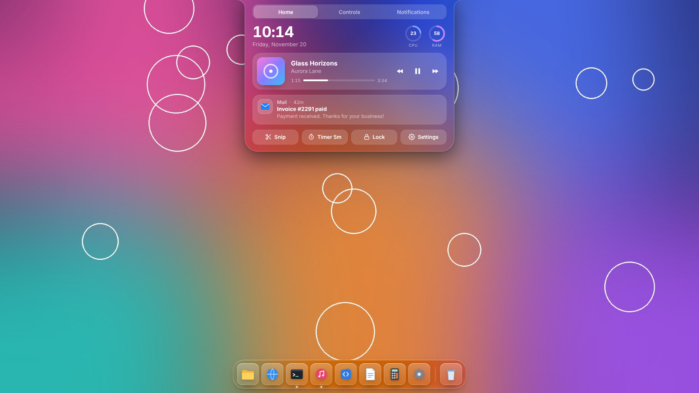
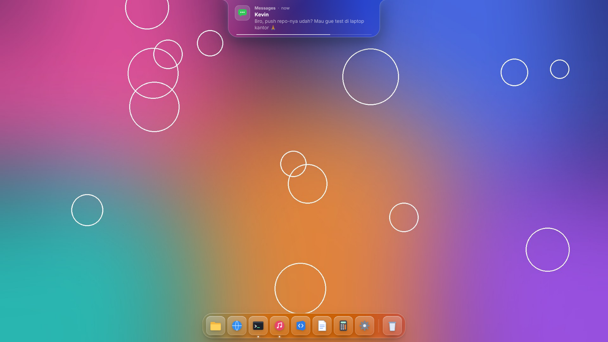
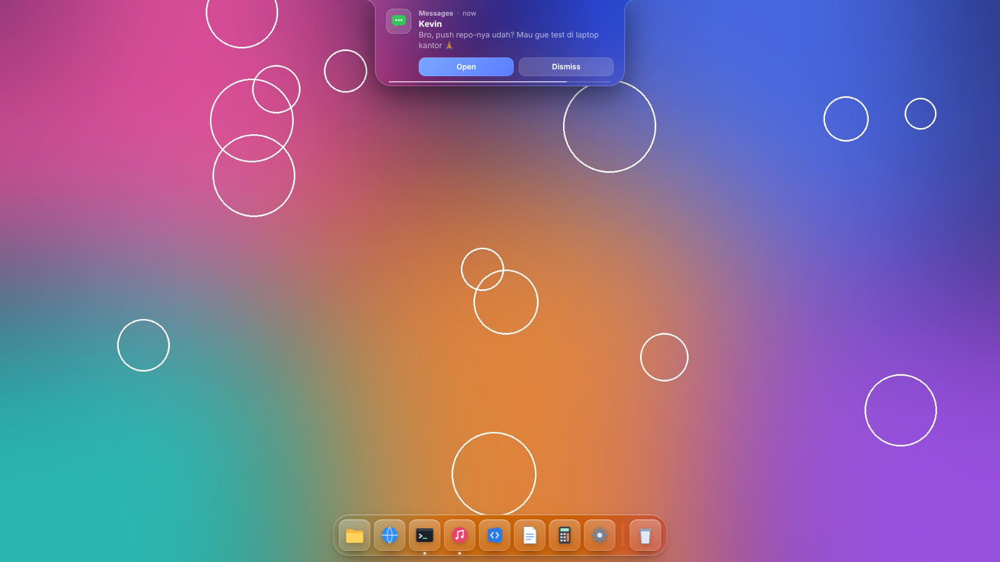
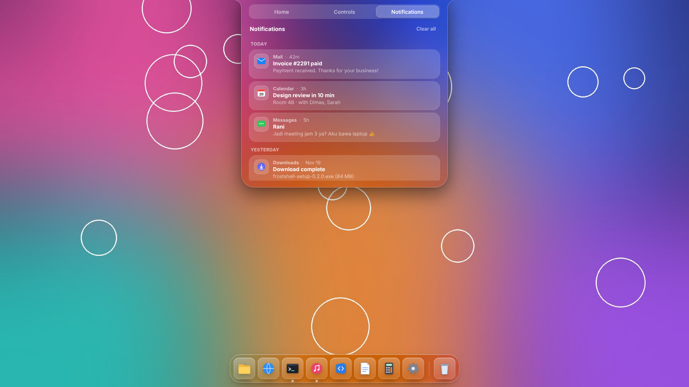
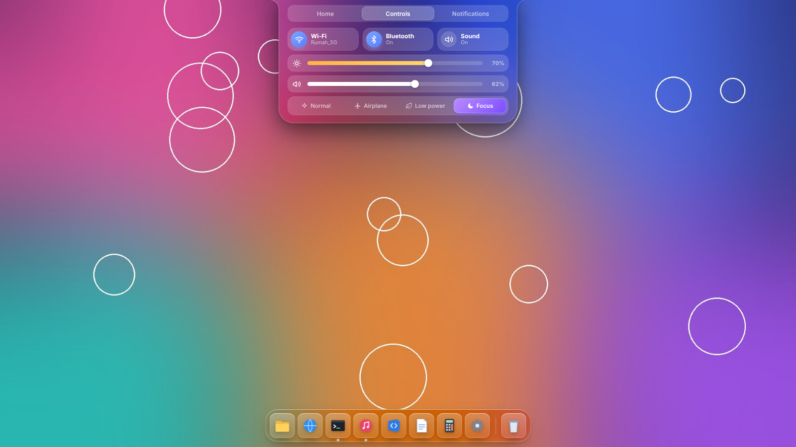
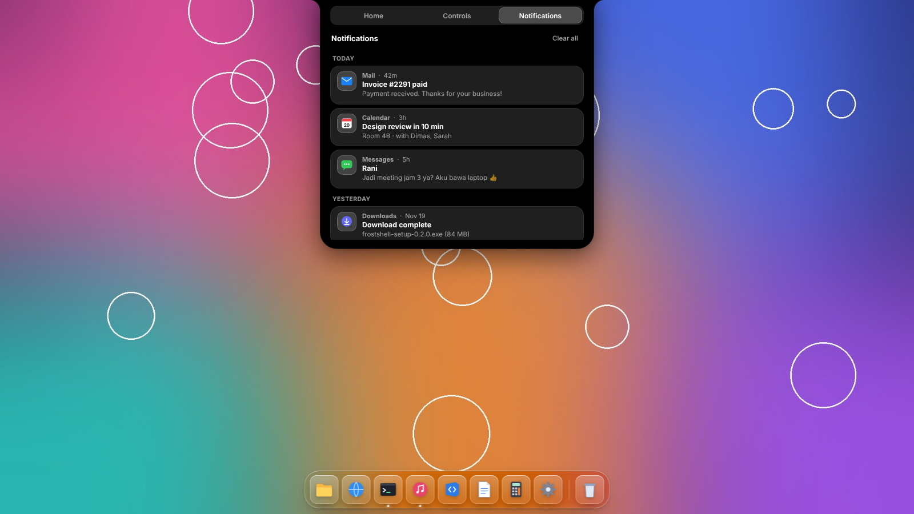

<div align="center">


# FrostShell

**A glassmorphism dock + notch for Windows 11.**

A macOS-style magnifying dock and a MacBook-style notch with notifications, quick settings, media controls, and live activities, all in frosted glass.




</div>

---

## ✨ Features

### 🔳 Notch
A MacBook-style notch that hangs from the top edge of the screen: square top, rounded bottom, and concave "ears" that flare into the screen edge, in frosted glass or solid black.

- **Shrinks when idle and grows as your cursor approaches** (proximity magnification, like the dock), then expands on hover
- **Compact notch** shows the clock, a spinning album-art disc, an equalizer while music plays, and a red **unread badge**
- **Expanded panel** with three tabs:
  - **Home**: big clock + date, CPU/RAM/battery rings, now-playing card, latest notification, quick actions
  - **Controls**: ☀️ brightness · 🔊 volume (scroll wheel works) · 🔇 mute · 📶 Wi-Fi · 🦷 Bluetooth · modes **Normal / Airplane / Low power / Focus**. Right-click any control to open its Windows Settings page
  - **Notifications**: everything in Windows Notification Center, grouped by day, with app icons, *open*, *dismiss* and *clear all*
- **Media controls** for anything in Windows' media flyout (Spotify, YouTube in Chrome/Edge, Apple Music, VLC…), via the native SMTC API
- **Live activities** that morph the notch: 🎵 track changed · ⚡ charger plugged/unplugged · ⏱️ timer with countdown + chime · ✈️/🌙 mode changes
- **Spring physics** between every state; corner and ear radii animate with the size

#### 🔔 How new notifications behave
1. **It drops down from the notch** as a toast (app icon, app name, title, 2-line preview) with a soft glow and a draining progress bar (6 s).
2. **Hover to hold it**: the timer pauses and **Open / Dismiss** buttons slide in. Click anywhere on it to open the app.
3. **Several at once queue up**: a `+2` chip shows what's waiting, and queued ones get a shorter turn so you aren't stuck watching them.
4. **Missed it?** The notch keeps a red **unread badge**. The next time you hover, the panel opens straight on the **Notifications** tab and marks them read.
5. **Focus mode on** means no pop-ups, only the badge count, silently.

> Notifications are read from Windows' own notification database (read-only), so you get every app's notifications, including chat avatars. *Dismiss* hides them in FrostShell only. To avoid seeing each one twice, turn off **Show notification banners** for chatty apps in *Settings → System → Notifications*; they still reach Notification Center and FrostShell.

### 🚀 Dock
- **macOS-style magnification** with smooth cosine falloff
- **Native Windows icons** for everything (Win32 `.exe`/`.lnk`, Microsoft Store apps, Settings, Recycle Bin…), extracted at up to 256 px so they stay sharp when magnified
- **Uniform square plates**: every icon sits on the same rounded-square glass tile, so mixed icon shapes line up neatly (`"iconStyle": "plain"` turns it off)
- **Running indicators** (dot under apps that are open)
- **Launch bounce** animation
- **Drag to reorder**, right-click → *Add app…*, *Remove*, *Show file location*, *Add separator*
- **Auto-hide** with a bottom hot-edge
- Supports `.exe`, `.lnk`, URIs (`ms-settings:`, `spotify:`…) and custom args

### 🧊 Glassmorphism done properly
CSS `backdrop-filter` **can't** see the desktop behind a transparent window, so most "glass" widgets end up as flat translucent boxes. FrostShell reads your **current wallpaper** (including Spotlight/slideshow via `TranscodedWallpaper`), places a copy behind every glass surface aligned to its exact screen position, and blurs + saturates *that*. On top of that you get a specular rim, a soft sheen gradient, and film-grain noise. It updates automatically when the wallpaper changes.

Prefer something simpler? Switch to **Tint only** mode from the tray.

<table>
<tr>
<td></td>
<td></td>
</tr>
<tr>
<td></td>
<td></td>
</tr>
<tr>
<td></td>
<td></td>
</tr>
</table>

> Screenshots come from `docs/preview.html` with a demo wallpaper. Open it in a browser to play with the UI without installing anything.

---

## 📦 Install

### Option A: download a release
Grab `FrostShell-Setup-x.y.z.exe` (installer) or the portable `.exe` from **Releases**.

### Option B: run from source
```bash
git clone https://github.com/gilbertknny/customDock.git
cd customDock
npm install
npm start          # run
npm run demo       # run with fake media data
npm run dist       # build installer + portable exe into dist/
```
Requires **Node.js 20+** and **Windows 10 1809+ / Windows 11** (best on 11).

### Recommended Windows settings
- **Auto-hide the taskbar** (Settings → Personalization → Taskbar → Taskbar behaviors) so the dock can sit at the very bottom, then set `"aboveTaskbar": false`.
- Turn on **Start with Windows** from the FrostShell tray menu.

---

## ⚙️ Configuration

Everything lives in `%APPDATA%\FrostShell\config.json` (tray → *Edit config…*). Changes apply **live** when you save.

```jsonc
{
  "theme": "auto",                 // auto | dark | light
  "glass": {
    "mode": "wallpaper",           // wallpaper | tint
    "blur": 26,                    // px
    "saturation": 1.8,
    "tint": 0.22,                  // 0–1 tint layer opacity
    "border": 0.28,                // rim highlight strength
    "noise": 0.05                  // film grain
  },
  "dock": {
    "enabled": true,
    "iconSize": 50,
    "magnification": 1.65,         // 1 = off
    "autoHide": false,
    "aboveTaskbar": true,
    "margin": 10,
    "iconStyle": "square",         // square (uniform plate) | plain
    "items": [
      { "name": "Edge", "path": "%ProgramFiles(x86)%\\Microsoft\\Edge\\Application\\msedge.exe" },
      { "name": "Terminal", "path": "shell:AppsFolder\\Microsoft.WindowsTerminal_8wekyb3d8bbwe!App", "process": "WindowsTerminal.exe" },
      { "name": "Settings", "path": "ms-settings:", "process": "SystemSettings.exe" },
      { "type": "separator" },
      { "name": "Recycle Bin", "path": "shell:RecycleBinFolder", "process": false }
    ]
  },
  "notch": {
    "enabled": true,
    "style": "glass",              // glass | black
    "idleScale": 0.75,             // size at rest (1 = never shrink)
    "proximity": 240,              // px: cursor distance where growing starts
    "clock24h": true,
    "showSeconds": false,
    "expandOnHover": true,         // false = click to expand
    "activityDuration": 3500,
    "notifications": {
      "enabled": true,
      "popup": true,               // false = badge only, never drop down
      "duration": 6000,            // ms a toast stays (paused while hovered)
      "max": 50                    // items kept in the list
    },
    "quickActions": [
      { "label": "Snip", "icon": "scissors", "uri": "ms-screenclip:" },
      { "label": "Timer 5m", "icon": "timer", "action": "timer", "minutes": 5 },
      { "label": "Lock", "icon": "lock", "path": "rundll32.exe", "args": ["user32.dll,LockWorkStation"] }
    ]
  }
}
```

**Dock item fields**

| Field | Description |
|---|---|
| `name` | Tooltip label |
| `path` | `.exe`, `.lnk`, folder, URI (`ms-settings:`, `steam://…`), `shell:RecycleBinFolder`, or a Store app as `shell:AppsFolder\\<AUMID>`. `%ENV%` vars are expanded |
| `args` | Optional argument array |
| `icon` | Optional override. By default the app's own Windows icon is used. Accepts `.png/.ico/.jpg`, or a resource like `%WINDIR%\\System32\\imageres.dll,-55` |
| `process` | Process name for the running dot. Defaults to the exe name; `false` disables it |

**How the controls work** (no admin rights needed, all through one PowerShell bridge):

| Control | Implementation | Note |
|---|---|---|
| Volume / mute | Core Audio `IAudioEndpointVolume` | default output device |
| Brightness | WMI `WmiMonitorBrightness` | built-in laptop screens; external monitors show *N/A* |
| Wi-Fi / Bluetooth | WinRT `Windows.Devices.Radios` | same as the Quick Settings toggles |
| Airplane | turns every radio off, restores the previous ones when switched off | Windows has no public airplane API |
| Low power | Windows 11 power mode → *Best power efficiency* | |
| Focus | global "notifications off" setting | |

**Quick action icons:** `scissors`, `timer`, `lock`, `gear`, `music`, `bolt`, `plug`, `battery`.

> 💡 Tip: find a Store app's AUMID with `Get-StartApps` in PowerShell.

---

## 🧱 How it works

```
src/
├── main.js              # windows, tray, IPC, launching, frost:// protocol
├── preload.js           # safe bridge (contextIsolation + sandbox)
├── config.js            # load/merge/watch config.json
├── system/
│   ├── media.ps1        # WinRT SMTC bridge (now playing + controls)
│   ├── media.js         # long-running PowerShell watcher, art cache
│   ├── icons.ps1/.js    # native Windows icon extraction (exe/dll + Store apps)
│   ├── controls.ps1/.js # volume, brightness, radios, power mode, focus
│   ├── notifications.js # mirrors Windows Notification Center (read-only)
│   ├── wallpaper.js     # finds & watches the current wallpaper
│   ├── processes.js     # running-app detection (tasklist)
│   └── stats.js         # CPU / RAM
└── renderer/
    ├── shared/          # glass.css, ui.js (glass alignment, click-through), icons
    ├── dock/
    └── notch/
```

- Both surfaces are **transparent, frameless, always-on-top, non-focusable** windows. Empty pixels pass clicks through to the desktop (`setIgnoreMouseEvents` with forwarding); only elements marked `data-hit` catch the mouse.
- Glass layers are re-aligned every animation frame while things morph, so the blur always matches what's actually behind it.
- The media bridge is a single PowerShell process that prints JSON lines, so there's no native Node module to compile.

---

## 🗺️ Roadmap
- [ ] Multi-monitor (dock per display)
- [ ] Left/right dock positions
- [ ] Hide over fullscreen apps & games
- [ ] Inline reply / toast action buttons
- [ ] Volume / brightness OSD replacement (show hardware-key changes in the notch)
- [ ] Wi-Fi network picker
- [ ] Native acrylic/mica mode (blur real windows, not only the wallpaper)
- [ ] Settings GUI
- [ ] Window previews on dock hover

PRs are very welcome!

---

## 🇮🇩 Bahasa Indonesia

**FrostShell** itu dock ala macOS + notch ala MacBook buat Windows 11, dengan gaya glassmorphism.

- **Notch**: nempel di tepi atas layar, mengecil pas diam dan membesar saat kursor mendekat. Hover buat buka panel dengan 3 tab: **Home** (jam, musik, CPU/RAM/baterai), **Controls** (kecerahan, volume, mute, WiFi, Bluetooth, mode Normal / Airplane / Low power / Focus), dan **Notifications** (semua notifikasi Windows).
- **Notifikasi baru** turun dari notch sebagai toast selama 6 detik. Hover buat nahan dan muncul tombol Open/Dismiss. Kalau kelewat, ada badge merah di notch, dan pas di-hover langsung kebuka di tab Notifications. Kalau mode Focus nyala, cuma badge aja tanpa pop-up.
- **Dock**: efek magnify, ikon asli bawaan Windows (diseragamkan di atas alas kotak), indikator app yang lagi jalan, drag buat ngatur urutan, auto-hide.
- **Glass beneran**: wallpaper kamu di-blur di belakang tiap panel, jadi efek kacanya kelihatan nyata, bukan cuma kotak transparan.

Cara pakai: `npm install` lalu `npm start`. Pengaturan ada di `%APPDATA%\FrostShell\config.json` (klik kanan ikon tray → *Edit config…*). Saran: nyalakan *auto-hide taskbar* Windows biar dock-nya bisa nempel di bawah.

---

## License
MIT. Not affiliated with Apple or Microsoft.
